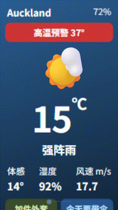
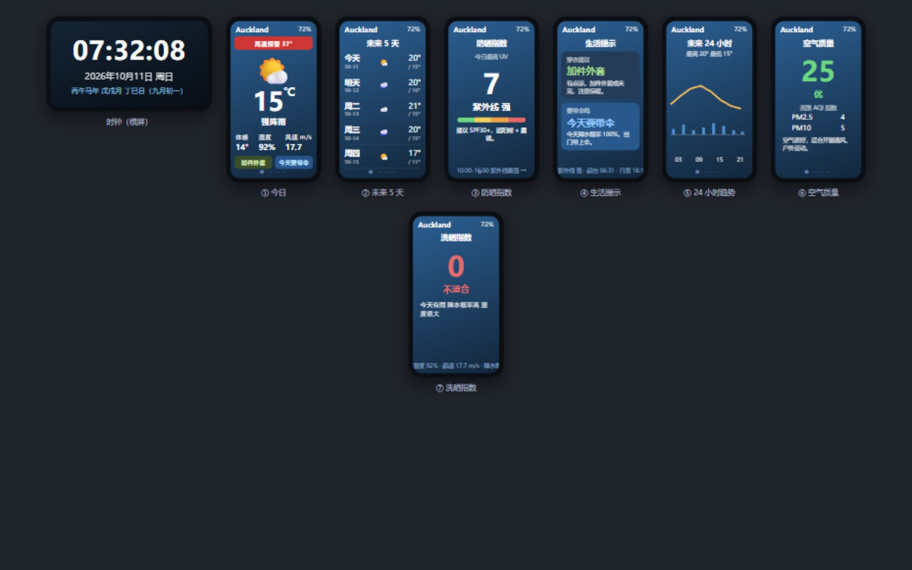

# StickS3 Weather Clock · 校园天气机

A polished **weather station for M5Stack StickS3 (ESP32-S3)** — made as a desk gadget for students living in dorms.
Clock with Chinese calendar, 7 weather pages, bilingual (中文 / English), offline voice announcements, weather alerts, an alarm, WiFi OTA and a custom phone setup page.

[中文说明](README.zh-CN.md) · [简体中文]



All 8 screens:



---

## Features

**Clock page** (landscape, shown on wake)
- Big `HH:MM:SS`, Gregorian date + weekday
- Chinese sexagenary calendar (干支) with the lunar date — e.g. `丙午马年 戊戌月 丁巳日（九月初一）`

**7 weather pages** (portrait)

| # | Page | Content |
|---|---|---|
| ① | Today | City / battery / time, **animated weather icon**, big temperature, feels-like · humidity · wind, clothing & umbrella tags |
| ② | Next 5 days | weekday + icon + high/low |
| ③ | UV index | today's max UV, level, colour bar, SPF advice |
| ④ | Daily tips | clothing & umbrella cards, scrolling UV / sunrise / sunset |
| ⑤ | 24-hour trend | animated temperature line + precipitation bars |
| ⑥ | Air quality | US AQI + category + PM2.5 / PM10 + advice |
| ⑦ | Drying index | laundry-drying score + reasons + scrolling details |

**More**
- ⚠️ **Weather alerts** — heat / cold / rain / thunder / fog / wind / pollution / extreme UV shown as a red banner on the Today page
- 🎙 **Offline voice announcement** — today's temperature, conditions, feels-like, humidity, wind, UV, umbrella reminder. 普通话 / English, female / male voice
- ⏰ **Wake-up alarm** — ring + announce the weather at a set time
- 🌏 **Bilingual** — 简体中文 / English (device UI + setup page)
- 🔌 **Two data sources** — Open-Meteo (default) or a custom Open-Meteo-compatible endpoint
- 🔋 **Power saving** — auto screen-off (30 s day / 8 s night), 80 MHz CPU
- 📶 **Custom setup page** — AP hotspot + a clean web UI to set WiFi, city, language, voice, alarm, alerts
- ⬆️ **WiFi OTA** — update firmware over the air, no cable
- Weather icons are drawn with graphics primitives (no image assets)

## Hardware

- **M5Stack StickS3 (K150)** — ESP32-S3, 8 MB Flash, 8 MB PSRAM
- 1.14" ST7789P3 LCD (135×240), ES8311 codec + speaker + MEMS mic, BMI270 IMU, 250 mAh battery

## Getting started

### 1. First boot / setup

1. On first boot the device starts a WiFi hotspot **`StickS3-Weather`** (open).
2. Connect your phone to it and open **`http://192.168.4.1`**.
3. Pick your WiFi, enter the password and a city name (Chinese or English), then **Save & Connect**.
4. The device connects and shows the weather.

> To change settings later, **double-click KEY2** to open the setup hotspot again (keeps your WiFi).
> To fully re-provision, **hold KEY2 for 3 s**.

> ⚠️ Campus WiFi that needs a web login (captive portal) will not work — use a normal WPA2 WiFi or a phone hotspot.

### 2. Buttons

| Action | Function |
|---|---|
| KEY1 click | clock → weather pages 1…7 → clock (loop) |
| KEY1 hold | announce weather (if the trigger is set to “Hold KEY1”) |
| KEY2 click | refresh weather |
| KEY2 double-click | open the setup hotspot |
| KEY2 hold 3 s | clear WiFi & reconfigure |
| any key when off | wake to the clock |

### 3. Build & flash

```bash
cd StickS3-Weather

# build
pio run

# flash firmware over USB (enter download mode first: hold the side power key until the green LED blinks)
pio run -t upload --upload-port COM5

# flash the voice assets (file system) — needed once
pio run -t uploadfs --upload-port COM5
```

OTA (over WiFi, from the same LAN as the device):

```powershell
powershell -ExecutionPolicy Bypass -File ota.ps1        # auto-detects the device by MAC
```

## Voice assets

Voice clips are generated on a PC (Windows SAPI + ffmpeg → 16 kHz IMA-ADPCM) and stored in the device file system.

```bash
python tools/gen_voice.py            # regenerate all (zh/en × female/male) into data/audio/
pio run -t uploadfs                  # write them to the device
```

## Project structure

```
StickS3-Weather/
├─ platformio.ini        # ESP32-S3 / 8MB / PSRAM
├─ ota.ps1 / flash.ps1   # one-click OTA / USB flash
├─ src/
│  ├─ config.h           # constants
│  ├─ main.cpp           # setup / loop: provisioning, clock, buttons, power, OTA
│  ├─ weather.h/.cpp     # geocoding + forecast + air quality (default/custom API)
│  ├─ lunar.h/.cpp       # Chinese lunar + sexagenary calendar
│  ├─ i18n.h/.cpp        # 中文 / English
│  ├─ portal.h/.cpp      # custom setup web page
│  ├─ voice.h/.cpp       # offline voice (ADPCM decode + speaker)
│  ├─ icons.h/.cpp       # animated weather icons
│  └─ ui.h/.cpp          # clock + 7 pages
├─ data/audio/           # voice clips (zh/en × female/male)
├─ tools/                # gen_voice.py, serial_log.py
└─ docs/                 # preview image + source
```

## Data

Weather and air quality come from **[Open-Meteo](https://open-meteo.com)** (free, no API key). The lunar / sexagenary calendar is computed on-device.

## License

[MIT](LICENSE)
